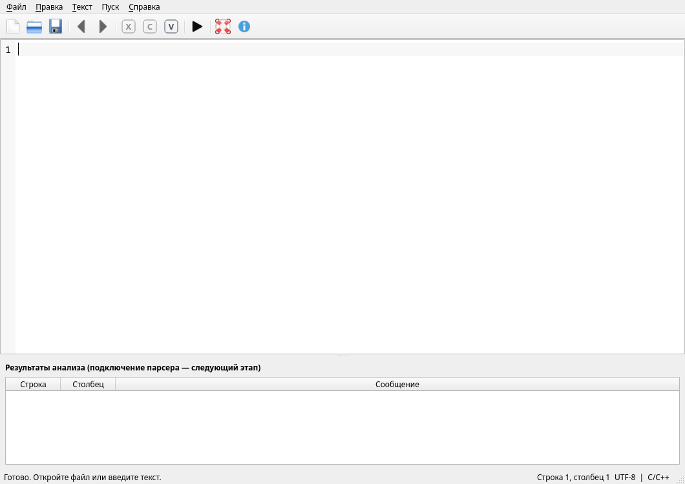
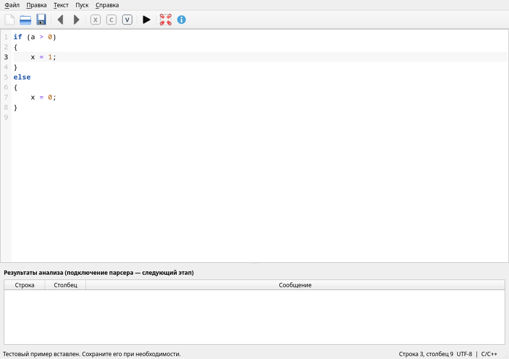
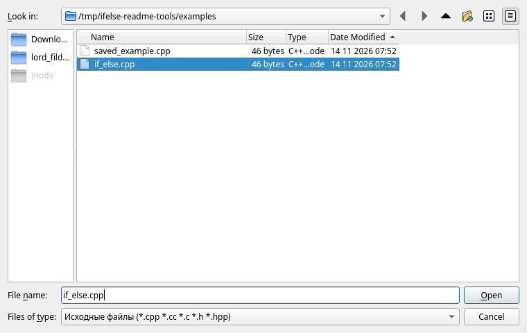
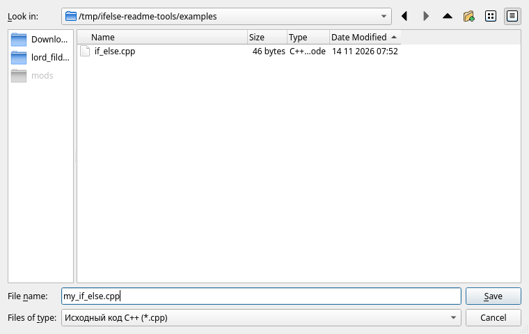
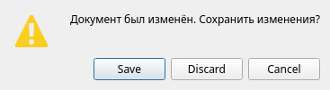
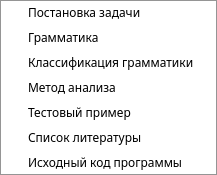
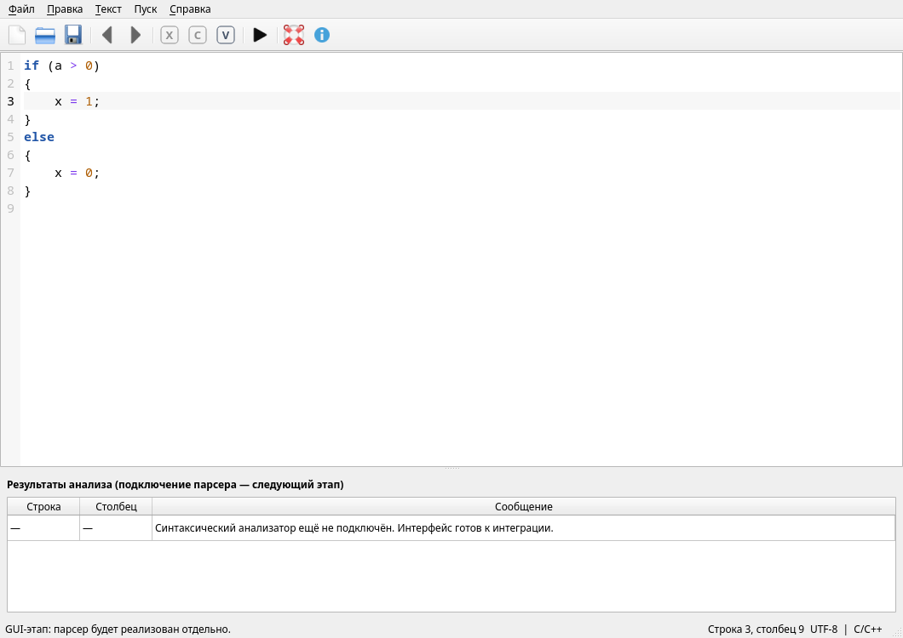
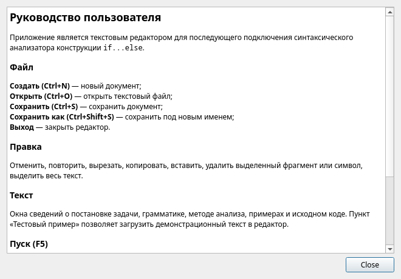
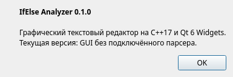

# Руководство пользователя

**Версия 0.1.0.** Настольный редактор для подготовки текстов с конструкцией `if ... else` языка C/C++. Приложение позволяет создавать, открывать, редактировать и сохранять файлы, подсвечивает отдельные элементы кода и предоставляет справочные материалы.



*Рисунок 1. Окно после запуска: редактор сверху, область результатов снизу, меню и панель инструментов над редактором.*

## Содержание

1. [Требования, сборка и запуск](#1-требования-сборка-и-запуск)
2. [Быстрое знакомство](#2-быстрое-знакомство)
3. [Устройство главного окна](#3-устройство-главного-окна)
4. [Работа с файлами](#4-работа-с-файлами)
5. [Редактирование текста](#5-редактирование-текста)
6. [Тестовый пример и меню «Текст»](#6-тестовый-пример-и-меню-текст)
7. [Запуск анализа и область результатов](#7-запуск-анализа-и-область-результатов)
8. [Справка и сведения о программе](#8-справка-и-сведения-о-программе)
9. [Сочетания клавиш](#9-сочетания-клавиш)

## 1. Требования, сборка и запуск

### Что понадобится

Для сборки из исходников необходимы:

| Компонент | Требование |
| --- | --- |
| Компилятор C++ | Поддержка C++17 |
| CMake | Версия 3.16 или новее |
| Qt | Версия 6.2 или новее, модули разработки Qt Widgets; для автоматических тестов — Qt Test |
| Средство сборки | Совместимое с выбранным генератором CMake: например, Ninja, Make или Visual Studio |
| Окружение для запуска | Графическая сессия и библиотеки Qt, необходимые собранному приложению |


### Сборка из исходников

Откройте терминал в каталоге проекта, где находится `CMakeLists.txt`, и выполните:

```sh
cmake -S . -B build -DCMAKE_BUILD_TYPE=Release
cmake --build build --config Release --parallel
```

Если CMake не находит установленный Qt, укажите каталог его комплекта. Замените путь в примере на свой:

```sh
cmake -S . -B build -DCMAKE_BUILD_TYPE=Release -DCMAKE_PREFIX_PATH="/path/to/Qt/6.x/kit"
cmake --build build --config Release --parallel
```

Указывать нужно каталог комплекта Qt, содержащий `lib/cmake/Qt6`, а не каталог `bin`.

### Автоматические проверки

По умолчанию вместе с приложением собираются тесты работы с документами и интерфейсом. Для их запуска после сборки выполните:

```sh
cmake -E chdir build ctest -C Release --output-on-failure
```

Тесты запускаются без графического дисплея через платформу Qt `offscreen`. Они проверяют сохранение UTF-8, сохранность документа при ошибках, навигацию, перетаскивание файлов и обработку несохранённых изменений.

Если требуется собрать только приложение без Qt Test:

```sh
cmake -S . -B build -DCMAKE_BUILD_TYPE=Release -DBUILD_TESTING=OFF
cmake --build build --config Release --parallel
```

Устройство классов, правила владения объектами и настройки разработки описаны в [руководстве для разработчика](docs/DEVELOPMENT.md).

### Запуск

Путь зависит от операционной системы и генератора CMake:

| Окружение | Типовая команда из каталога проекта |
| --- | --- |
| Linux, одноконфигурационная сборка | `./build/IfElseAnalyzer` |
| Windows, Visual Studio, Release | `.\build\Release\IfElseAnalyzer.exe` |
| Windows, одноконфигурационная сборка | `.\build\IfElseAnalyzer.exe` |
| macOS, одноконфигурационная сборка | `open build/IfElseAnalyzer.app` |

При использовании многоконфигурационного генератора исполняемый файл или пакет приложения может находиться в подкаталоге `Release`. Если готовый исполняемый файл уже предоставлен вместе с необходимыми библиотеками, запустите его через файловый менеджер.

После запуска появляется пустой документ «Безымянный». Файл для редактирования открывается через меню **Файл → Открыть…** или перетаскиванием в редактор.

## 2. Быстрое знакомство

1. Запустите приложение.
2. Выберите **Текст → Тестовый пример**.
3. Подтвердите вставку кнопкой **Да**. В редакторе появится конструкция `if ... else`.
4. Измените условие или значение присваивания, например `x = 1;` на `x = 10;`.
5. Нажмите **Ctrl+S**, выберите каталог и имя, например `example.cpp`, затем подтвердите сохранение.
6. Нажмите **F5**, чтобы вызвать команду анализа.
7. Завершите работу через **Файл → Выход** или кнопку закрытия окна. Если после последнего сохранения текст менялся, приложение предложит сохранить изменения.



*Рисунок 2. Вставленный тестовый пример. Слева видны номера строк, ключевые слова, числа и операторы выделены цветом. В строке состояния отображается позиция курсора.*

## 3. Устройство главного окна

| Элемент | Назначение и работа с ним |
| --- | --- |
| Заголовок окна | Показывает имя текущего файла и название приложения. Для нового файла используется имя «Безымянный». Звёздочка `*` означает, что документ содержит несохранённые изменения. |
| Строка меню | Содержит разделы **Файл**, **Правка**, **Текст**, **Пуск**, **Справка**. |
| Панель инструментов | Предоставляет быстрый доступ к основным командам. Наведите указатель на значок, чтобы увидеть подсказку. |
| Редактор | Основная область ввода текста с нумерацией строк и подсветкой текущей строки. |
| Горизонтальный разделитель | Находится между редактором и результатами. Перетащите его вверх или вниз, чтобы изменить высоту областей. |
| Область результатов | Таблица с колонками **Строка**, **Столбец**, **Сообщение**.|
| Строка состояния | Слева временно показывает сообщения об открытии, сохранении и других действиях; справа — позицию курсора и обозначение `UTF-8 \| C/C++`. |

## 4. Работа с файлами

Одновременно в окне открыт один документ. Создание нового файла, открытие другого файла и вставка примера заменяют содержимое редактора.

### Создать документ

1. Выберите **Файл → Создать**, нажмите кнопку создания на панели или **Ctrl+N**.
2. При наличии несохранённых изменений ответьте на запрос сохранения.
3. Начните ввод в пустом редакторе.

Новый документ получает имя «Безымянный», а таблица результатов очищается. Файл на диске появится после сохранения.

### Открыть существующий файл

1. Выберите **Файл → Открыть…**, кнопку открытия или **Ctrl+O**.
2. В диалоге перейдите в нужный каталог и выберите файл.
3. Подтвердите открытие кнопкой **Open / Открыть**.
4. Если текущий документ изменён, сохраните его, откажитесь от изменений или отмените открытие.



*Рисунок 3. Выбор файла для открытия. Фильтр внизу ограничивает отображаемые расширения; для остальных файлов выберите «Все файлы (*)».*

В диалоге доступны фильтры:

- **Исходные файлы:** `*.cpp`, `*.cc`, `*.c`, `*.h`, `*.hpp`.
- **Текстовые файлы:** `*.txt`.
- **Все файлы:** `*`.

Фильтр помогает найти файл и не определяет возможность синтаксической проверки. Приложение читает содержимое выбранного файла как текст **UTF-8**. После успешного открытия имя появляется в заголовке, прежние результаты очищаются.

**Перетаскивание:** перетащите один локальный файл из файлового менеджера непосредственно в область редактора. Он откроется с тем же запросом о несохранённых изменениях. Этот способ рассчитан на один файл; для работы с несколькими файлами открывайте их последовательно. Перетаскивание папок и удалённых ссылок как документов не предусмотрено.

### Сохранить документ

Выберите **Файл → Сохранить**, кнопку сохранения или **Ctrl+S**.

- Если документ уже связан с файлом, приложение записывает изменения по текущему пути.
- Если документ ещё не сохранялся, открывается диалог выбора имени и каталога.

### Сохранить под другим именем

1. Выберите **Файл → Сохранить как…** или **Ctrl+Shift+S**.
2. Укажите каталог и новое имя.



*Рисунок 4. Сохранение под новым именем. После сохранения дальнейшая команда «Сохранить» будет работать с выбранным файлом.*

**Расширение лучше вводить явно.** Если у выбранного имени нет расширения, приложение добавляет `.cpp`, в том числе при выборе фильтра текстовых файлов. Например, `example` сохраняется как `example.cpp`; для текстового файла введите `example.txt`.

Все документы сохраняются в **UTF-8**. После «Сохранить как…» редактор связан с новым путём; ранее существовавший файл по старому пути не удаляется.

### Запрос о несохранённых изменениях

При создании документа, открытии другого файла, вставке примера и закрытии окна приложение проверяет наличие изменений.



*Рисунок 5. Защита от случайной потери изменений.*

| Кнопка | Что произойдёт |
| --- | --- |
| **Save / Сохранить** | Приложение сохранит документ и продолжит выбранное действие. Для нового файла сначала потребуется указать путь. |
| **Discard / Не сохранять** | Приложение продолжит действие без сохранения текущих изменений. |
| **Cancel / Отмена** | Действие будет отменено, текущий документ останется открытым. |

Если отменить диалог сохранения или запись завершится ошибкой, действие, для которого требовалось сохранение, не продолжится. Автоматического сохранения и восстановления после аварийного завершения нет: сохраняйте важные изменения самостоятельно.

### Завершить работу

Выберите **Файл → Выход** или закройте главное окно. При наличии изменений появится описанный выше запрос. Для продолжения редактирования выберите **Cancel / Отмена**.

## 5. Редактирование текста

Щёлкните в редакторе и вводите текст с клавиатуры. Позицию ввода можно менять мышью и клавишами перемещения курсора. Для выделения фрагмента протяните по нему указателем с нажатой левой кнопкой мыши; для выделения всего документа используйте **Ctrl+A**.

### Команды меню «Правка»

| Команда | Действие |
| --- | --- |
| **Отменить** | Отменяет последнее доступное действие редактирования. Повторные вызовы позволяют вернуться к более раннему состоянию. |
| **Повторить** | Восстанавливает отменённое действие, пока оно доступно в истории. |
| **Вырезать** | Удаляет выделенный текст и помещает его в буфер обмена. |
| **Копировать** | Помещает выделенный текст в буфер обмена. |
| **Вставить** | Вставляет текст из буфера в позицию курсора или заменяет выделенный фрагмент. |
| **Удалить** | Удаляет выделенный фрагмент, а при отсутствии выделения — символ справа от курсора. |
| **Выделить всё** | Выделяет весь текст документа. |

Чтобы заменить значение, выделите его и введите новое. Если изменение оказалось ошибочным, воспользуйтесь **Отменить**. Открытие файла, создание документа и вставка встроенного примера заменяют документ целиком.

### Возможности отображения

- **Номера строк** помогают ориентироваться в документе и сопоставлять текст с координатами сообщений.
- **Текущая строка** выделяется фоном; при перемещении курсора выделение перемещается вместе с ним.
- **Моноширинный шрифт** облегчает чтение кода и выравнивание отступов.
- **Табуляция** отображается с шагом, соответствующим ширине четырёх пробелов. Нажатие Tab не означает автоматическую замену табуляции четырьмя пробелами.

Подсветка различает следующие элементы:

| Элемент | Пример | Цвет в текущей реализации |
| --- | --- | --- |
| Ключевые слова | `if`, `else` | Синий, полужирный |
| Числа | `0`, `12`, `3.14` | Коричнево-оранжевый |
| Операторы | `=`, `>`, `==`, `&&`, `+` | Фиолетовый |
| Строки в двойных кавычках | `"text"` | Зелёный |
| Однострочные комментарии | `// комментарий` | Серо-синий |

Подсветка выполнена по простым текстовым правилам и не является проверкой синтаксиса. Она не охватывает все конструкции C/C++, например многострочные комментарии `/* ... */`.

## 6. Тестовый пример и меню «Текст»

Меню **Текст** содержит учебные материалы и команду вставки примера.



*Рисунок 6. Все пункты меню «Текст». Большинство открывают окно для чтения; «Тестовый пример» загружает текст в редактор.*

| Пункт | Содержимое в версии 0.1.0 |
| --- | --- |
| **Постановка задачи** | Описание задачи создания анализатора конструкции `if (условие) { действие; } else { действие; }` и текущего этапа разработки. |
| **Грамматика** | Сообщение о том, что раздел будет заполнен при разработке грамматики и анализатора. |
| **Классификация грамматики** | Сообщение о подготовке раздела; классификация пока не приведена. |
| **Метод анализа** | Сообщение о подготовке раздела; описание метода пока не приведено. |
| **Тестовый пример** | Запрос на вставку демонстрационного фрагмента в редактор. |
| **Список литературы** | Сведения об учебном издании Ю. В. Шорникова «Теория языков программирования: проектирование и реализация», НГТУ, 2022. |
| **Исходный код программы** | Указание расположения исходников: `src/gui` и `src/main.cpp`. Содержимое исходных файлов в этом окне не показывается. |

Чтобы вернуться из информационного окна к редактору, нажмите **Close / Закрыть** или закройте это окно.

### Вставка встроенного примера

1. Выберите **Текст → Тестовый пример**.
2. На вопрос «Вставить демонстрационный пример if...else в редактор?» ответьте **Да**. Ответ **Нет** оставит документ без изменений.
3. Если текущий документ изменён, ответьте на отдельный запрос о сохранении.
4. В редактор будет загружен следующий текст:

```cpp
if (a > 0)
{
    x = 1;
}
else
{
    x = 0;
}
```

**Пример заменяет весь документ**, а не вставляется в позицию курсора. После загрузки он становится новым несохранённым документом «Безымянный», таблица результатов очищается. Чтобы оставить фрагмент на диске, сохраните его отдельным файлом.

## 7. Запуск анализа и область результатов

Вызвать команду можно тремя способами:

- **Пуск → Запустить синтаксический анализ**.
- Кнопкой запуска на панели инструментов.
- Клавишей **F5**.



*Рисунок 7. Фактический результат F5 сообщение о неподключённом анализаторе. Прочерки вместо координат показывают, что сообщение не связано с конкретной позицией в тексте.*

### Назначение колонок и навигации

Область результатов подготовлена для будущих диагностических сообщений:

- **Строка** — номер строки, к которой относится сообщение.
- **Столбец** — позиция внутри строки.
- **Сообщение** — описание результата или проблемы.

Таблица доступна только для чтения. Высоту нижней области можно изменить разделителем. При создании документа, открытии файла и загрузке примера результаты очищаются; обычное редактирование и сохранение автоматически анализ не запускают.

## 8. Справка и сведения о программе

### Встроенное руководство

Выберите **Справка → Вызов справки**, кнопку справки на панели или **F1** в Linux/Windows. Откроется окно «Руководство пользователя» с кратким описанием меню и основных действий.



*Рисунок 8. Встроенная справка. Если текст не помещается, прокрутите содержимое окна. Для возврата к редактору нажмите «Close / Закрыть».*

### О программе

Выберите **Справка → О программе** или соответствующую кнопку панели инструментов. Окно содержит название, версию **0.1.0**, сведения о C++17 и Qt 6 Widgets, а также указание на отсутствие подключённого парсера.



*Рисунок 9. Сведения о версии приложения. Они помогают определить, к какой версии относится наблюдаемое поведение.*

## 9. Сочетания клавиш

Ниже приведены сочетания для Linux/Windows. Большинство из них приложение получает из стандартных сочетаний Qt.
| Действие | Сочетание |
| --- | --- |
| Создать документ | **Ctrl+N** |
| Открыть файл | **Ctrl+O** |
| Сохранить | **Ctrl+S** |
| Сохранить как | **Ctrl+Shift+S** |
| Выйти | Через **Файл → Выход**; наличие отдельного сочетания зависит от платформы и отображается в меню |
| Отменить | **Ctrl+Z** |
| Повторить | **Ctrl+Y**; в зависимости от платформы Qt может назначить другое сочетание |
| Вырезать | **Ctrl+X** |
| Копировать | **Ctrl+C** |
| Вставить | **Ctrl+V** |
| Удалить выделение или символ справа | **Delete** |
| Выделить весь текст | **Ctrl+A** |
| Запустить команду анализа | **F5** |
| Вызвать справку | **F1** |
